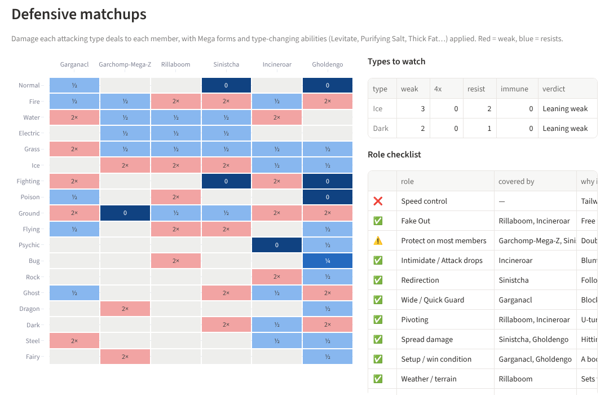

# Pokémon Champions Team Builder

[](https://github.com/mam084/pokemon-team-builder/actions/workflows/tests.yml)
[](https://github.com/mam084/pokemon-team-builder/actions/workflows/refresh-data.yml)

A team builder and analyzer for **Pokémon Champions**, built for the current
regulation (VGC 2026 Reg M-C and Battle Stadium Singles M-C, with Reg M-B kept
for reference). You build full competitive sets, the app checks them against the
regulation's rules, and then it measures the team against what people actually
play on the ladder.



## What it does

**Build a legal team**
- Every Pokémon, Mega Stone, item, ability and move list comes from the
  regulation's legal pool. Pokémon, items and moves are sorted by real usage,
  with each one's usage % shown.
- The editor uses Champions rules: level 50, **66 Stat Points with at most 32
  per stat**, and real level-50 stats for each nature. Mega Pokémon show their Mega
  stats, types and ability.
- When you pick a Pokémon, the app can fill in its most-used set (item, ability,
  spread and moves). It skips items your team already holds, so Item Clause
  is never broken.
- Legality checks cover Species Clause, Item Clause, illegal moves and abilities,
  and Stat Point limits. You also get a warning when more than one Pokémon holds
  a Mega Stone, since only one can Mega Evolve per battle.
- Import and export Showdown pastes.
- **Your team lives in the page link.** The address bar updates as you build,
  so refreshing or bookmarking the page keeps your team, and the **Share**
  link in the sidebar sends it to anyone. The team is stored as a compressed
  Showdown paste in the URL (`src/share.py`), so nothing is saved on a server
  and there are no accounts.

**Presets and roles**
- **Presets**: up to six common sets for each Pokémon, built from ladder stats.
  Each popular item (and each Mega) starts its own preset. The item shapes the
  rest of the set: Choice items drop status moves and Protect, and Choice Scarf
  picks a max-Speed spread. Apply a preset from the editor, or add one to the
  team straight from the Meta tab. Champions has no IVs; a "spread" is the
  nature plus Stat Points.
- **Roles**: what a Pokémon usually does (Fake Out support, Trick Room or
  Tailwind setter, Rain/Sun/Sand setter, redirector, Intimidate, Choice Scarf
  attacker, priority or spread attacker, bulky...). For meta Pokémon a role
  counts when at least 30% of sets run it, and the share is shown. For your own
  sets, roles come from your moves, item and ability. Roles appear in the team
  strip, the editor, recommendations and the meta views.

**Analyze it**
- **Defensive heatmap** shows how much damage each type does to each member.
  It uses the Mega forms and accounts for abilities that change type matchups
  (Levitate, Purifying Salt, Thick Fat, Water Absorb…). Shared weaknesses are
  flagged.
- **Role checklist**: speed control, Fake Out, Protect, Intimidate, redirection,
  Wide Guard, pivoting, spread damage, weather/terrain, disruption and recovery.
  The doubles-only roles are hidden in Singles.
- **Speed tiers** compare your real Speed stats with the meta's most common
  spreads. There's also a Trick Room view.
- **Offensive coverage** shows what your moves hit super effectively, by type and
  against the 30 most-used Pokémon in their usual battle form.

**Matchups vs the meta**
- Smogon stats don't record whole teams, so the app **rebuilds about 10 common
  meta teams** from teammate data. It starts from a popular Pokémon and keeps
  adding whoever is most often paired with everyone already on the team,
  respecting Species Clause and one Mega per team. Each team is named for what
  it sets up, e.g. *Rain + Tailwind (Archaludon + Pelipper)*, and every
  opponent uses its most popular set.
- Every pairing is decided by **real damage calcs in both directions**, using
  both sides' actual sets: **pair score** = log2(hits they need to KO you ÷
  hits you need to KO them), ±0.5 for Speed (reversed under Trick Room).
  Weather teams are scored in their weather. Moves whose power depends on
  weight or Speed (Low Kick, Grass Knot, Heavy Slam, Heat Crash, Gyro Ball,
  Electro Ball) use each side's real weight and Speed; Reversal, Flail and
  Hard Press assume full HP. **Team score** = how well you
  answer their Pokémon minus how well they answer yours, so a mirror match
  scores exactly 0.
- For each meta team you get a verdict, the best **bring 4** (or bring 3 in
  Singles), a pairing heatmap, your best answer to each of their Pokémon with
  the key calc (e.g. *Draco Meteor 83%*), and **counter picks** (meta Pokémon
  that beat that team).
- **Biggest threats**: the 30 most-used Pokémon ranked by
  `usage × (your Pokémon it 2HKOs + 1) ÷ (answers + 1)`, where an *answer*
  2HKOs it back while taking under 50%. Each row shows its hardest hits and
  the meta's best counters to it.

**Damage calculator**
- Level-50 Champions damage with **Showdown's exact formula and rounding**.
  `tests/test_damage.py` checks 102 cases roll-for-roll against Showdown's own
  engine (spread moves, weather, terrain, crits, screens, Helping Hand, stat
  stages, Body Press, Foul Play, Psyshock, Weather Ball, -ate abilities, Mega
  Sol, resist berries, Life Orb...).
- Pick any of your Pokémon or a meta Pokémon's popular set on either side, and
  see each move's damage range, % of HP and KO chance.

**Build around a Pokémon, and fix what's weak**
- **Build a whole team around one Pokémon**, right on the empty Team screen (and on the
  Recommendations tab): pick a core (or use your own set for it) and get three different
  complete teams. Each is filled one Pokémon at
  a time with the top recommendation, using popular sets that keep Item Clause
  and one Mega, then rated against the meta teams.
- **What players do with it** (`src/core_report.py`), shown as soon as you pick the core: its
  last 30 days of ladder and Bo3 games (wins next to what the players' ratings predicted, so a
  small sample isn't read as a verdict), its usual partners, the moves and items on Bo3 open
  team sheets, its tournament record and natures, what it beats one-on-one and what beats it
  (damage calcs). Each built team says which of those threats it answers, and you can start
  from a real winning team instead. Built twice a day with the replays
  (`data/replays/summary/<format>_cores.json`), so the app never loads replays.
- **Suggested swaps** (Matchups tab): "Garchomp → Emboar: Close Combat 116% to
  Incineroar, takes 22%". Pick a threat to fix, or ask for the best overall
  improvement. Every member × candidate swap is scored by **team score** (0-100:
  how the team compares with real tournament teams, from teammate fit plus the
  learned win chance vs the meta), and a swap is only offered if it doesn't make
  the team noticeably worse. One tap applies it.
- **Team grade** (Matchups tab): Strong, Solid, Shaky or Weak, by where the team
  score falls among real tournament teams (quarters, the precision the held-out
  test supports).
- **Recommendation style**, shared by recommendations, the builder and swaps:
  - *Popular picks*: the data-tuned defaults, which lean on proven meta Pokémon.
  - *Neutral*: popularity counts for nothing and every Pokémon with ladder data
    is considered.
  - *Hidden gems*: like Neutral, but the most-used Pokémon are marked down.
- **Game-plan synergy** (`src/plan.py`): the recommender knows what weather,
  Trick Room, Tailwind and terrain do. A Mega Froslass (Snow Warning) team gets
  Beartic (Slush Rush), Glaceon and Rotom-Frost (Blizzard never misses in snow)
  instead of the meta's usual partners. A Swift Swim team with no rain setter
  gets rain setters. The plan signal has diminishing returns, and once a plan
  has its core (two or more members using it), recommendations switch to
  **covering the core's weak spots**. Each weakness is weighted by how often
  the meta attacks with that type, so an Ice core gets Water/Fighting types or
  a Flash Fire Ceruledge, not a fifth Ice type.
- **Two Megas**: teams may carry two Mega Stones. The builder and swaps use
  that, and every matchup tells you which one to Mega Evolve.

**Find what's missing**
- **Recommendations**: every candidate gets five scores from 0 to 1, and you can
  change how much each one counts:

  | signal | meaning |
  |---|---|
  | synergy ("Fits") | how strongly players pair it with your **whole team**, from a teammate model learned on real teams (below). 0.5 = no pull either way. Formats without the model fall back to Smogon teammate lift |
  | defense | how well it resists the types your team is weak to |
  | offense | how well it hits popular Pokémon your team can't hit super effectively (weighted by usage) |
  | roles | whether it brings a role your team is missing |
  | meta | its overall usage, as a prior |

  Each pick's card explains itself in short lines (*Fits: Rillaboom (7.4x),
  Sinistcha (5.9x)*; *Watch: rarely run next to Garchomp (0.5x)*; *Covers: Ice,
  Dark, Steel*), shows how often players with your team pick it next, and has an
  **Add to team** button that adds its most popular set.
- **Spread tuner** (Team tab): pick a Speed to beat and up to 3 popular attacks to survive
  (each threat's strongest move against your set, at the highest roll); it finds the fewest
  Stat Points that do it, keeps your nature, and puts the rest into attack or bulk.
- **Tournament teams like yours** (Analysis tab): Limitless team lists that share most of
  your Pokémon, their combined record against the average, and the best finishes with what
  they ran differently.
- **Fit check** (Analysis tab): for each member, how usual it is next to the rest
  and what players most often run in that spot instead. Swaps use the same model:
  each member's second suggestion is the *usual pick* for that spot.
- **Meta explorer**: the usage leaderboard and each Pokémon's moves, items,
  abilities, spreads, teammates, and checks & counters.

## How accurate are the recommendations?

The recommender is tested on teams real players brought to
[Limitless](https://play.limitlesstcg.com) tournaments. Those teams are never
used to build it. The test (`src/evaluate.py`): take a real six, **hide one
member, give the other five to the recommender, and see where the hidden
Pokémon ranks** among about 68 candidates. This is repeated
for every member of every team.

<!-- generated:recommender -->
Tournaments are split by date. The teammate model learned from the 2,164 oldest teams (plus replays from before the next tournaments) and the weights were tuned by grid search on the next 1,497. Every number below comes from
1,761 teams in the 36 newest tournaments (2026-11-12 to
2026-11-18), which neither ever saw.

| model | top 1 | top 5 | top 10 | MRR |
|---|---|---|---|---|
| tuned weights | 56.0% | 79.4% | 86.2% | 0.665 |
| hand-set weights | 17.6% | 46.1% | 61.7% | 0.321 |
| synergy only | 56.0% | 79.4% | 86.2% | 0.665 |
| popularity only | 5.9% | 36.3% | 50.4% | 0.206 |
| before: lift synergy | 47.3% | 71.1% | 79.1% | 0.581 |
| random | 1.5% | 7.3% | 14.7% | 0.071 |

- The tuned weights find the missing Pokémon **first try 56% of the
  time** and in the top 10 86% of the time: 107% better MRR than the
  weights the recommender originally shipped with.
<!-- /generated:recommender -->
- **Two Mega Stones are normal**: 81% of these tournament teams carry two (you
  choose which Mega Evolves at team preview). Removing the old "second Mega"
  penalty raised test MRR from 0.475 to 0.507 on the same data. The matchup engine now scores a
  two-Mega team with whichever Mega Evolves best against each opponent, and says
  which one.
- The **game-plan signal** only helps a little: the tuning gives it a small
  weight (0.05), and more than that hurts (MRR falls to about 0.44 at 0.3).
  Tournament players mostly bring proven meta Pokémon rather than building
  around weather. So it does most of its work in the *Neutral* / *Hidden gems*
  modes, whose weights are a design choice rather than fitted. In Neutral mode on 400
  held-out teams the recommender still ranks the real missing Pokémon in its
  top 10 48% of the time among ~260 candidates (random: 4%).
- With the learned teammate model, tuning puts **all the weight on Fits**: for
  predicting real teams, popularity, type coverage, roles and game plan add nothing
  on top (the model already learned who players pick). Those signals still explain
  each pick in the app, drive the *Neutral* and *Hidden gems* styles, and can be
  raised under **Fine-tune the ranking**.
- *(Before the teammate model)* **Lift synergy also learned from tournament pairings** (`src/cooccurrence.py`):
  ladder teammate stats are weighted to high-rated players, so a Pokémon on
  0.05% of those teams is really one or two players. Thousands of tournament
  team sheets give those Pokémon real sample sizes. In a three-way date split
  (pairings from the oldest teams, weights tuned on the next, tested on the
  newest 30%), adding them raised synergy-only MRR from 0.393 to 0.463 and the
  full model from 0.539 to 0.556 (top 10: 74.2% to 76.9%).
- About 6% of hidden Pokémon are outside the candidate pool
  (the usage top 80), which caps every model's scores.
- `python scripts/evaluate.py` reproduces this. The monthly data refresh re-runs it on new tournaments.

### Learned synergy

Lift looks at one pair at a time, so it can't tell real partners apart from two
Pokémon that only show up together because both go with a third. The teammate
model (`src/synergy.py`) scores a candidate against the whole team at once, and is
fitted the way it's used: hide each member of a real team and predict it from the
rest.

    P(candidate c | team T)  ∝  exp( b_c + Σ_{m in T} W[m, c] )

`b_c` is how often c gets picked at all, and `W[m, c]` is the pull between two
Pokémon *after* accounting for the rest of the team. It's fitted on every tournament
team list (counted 3x) plus the last 30 days of ladder and Bo3 teams from replays
(each player's team once, higher ratings weighted more; older replays stopped
helping as the meta moved: 45+ days scored MRR 0.650 vs 0.656 for 30), with L2 regularisation so
rarely seen pairs stay near 0. `exp(W)` is the "7.4x" in the app's reasons.

`scripts/synergy_lab.py` compares it with lift on the same held-out tournaments
(model fitted only on older tournaments and replays):

| synergy measure (alone) | top 1 | top 10 | MRR |
|---|---|---|---|
| lift (ladder + tournament pairings) | 35.1% | 71.3% | 0.479 |
| learned, tournaments only | 53.4% | 81.7% | 0.629 |
| learned, ladder replays only | 54.3% | 83.3% | 0.643 |
| learned, both (shipped) | 55.2% | 84.7% | 0.655 |

**Can replays say which pairs *win* more together?** Not yet:
`scripts/win_synergy_lab.py` predicts the winners of 14,000 newer ladder games
from player ratings, plus the Pokémon on each team, plus every pair. Pairs moved
accuracy from 54.4% to 54.7% (log loss 0.6873 to 0.6870), which is noise at this
size, so recommendations use who players pair, not pair win rates.

## Does the matchup score predict wins?

The Matchups tab scores your team against others with damage calcs and Speed.
<!-- generated:validation -->
`src/validate.py` checks that score against **12,143 real Limitless
matches** where both players' team lists are known: each pair of teams is
scored against each other, a win-chance curve is fitted on the older
8,049 matches, and it's judged on the newest 4,094
(2026-11-12 to 2026-11-18).

| model | picks the winner | log loss |
|---|---|---|
| team vs team (bring 4) | 51.2% | 0.6940 |
| team vs team (all 6) | 51.1% | 0.6936 |
| score vs the meta | 51.3% | 0.6932 |
| popularity | 50.8% | 0.6930 |
| coin flip | 50.0% | 0.6931 |

Split into fifths by score, the side the model favors most strongly won
**53%** and the side it disfavors most strongly
**50%**, close to the fitted curve
(55% / 45%).
<!-- /generated:validation -->

- **The signal is real but small.** One game is mostly play and luck, so the
  app shows matchups as a calibrated win chance ("about 48% to win") rather
  than implying a favorable matchup is a sure thing.
- Player skill can't be read off the Swiss records: a player's record in their
  *other* matches predicts nothing here, because Swiss pairs players with equal
  records, so opponents start roughly even. That also makes these matches a
  fair test of team choice.
- The pair score's Speed bonus (0.5) was checked against 0 and 1.0 on the
  older matches; 0.5 fit best, so it stays.
- **Support** (screens, Intimidate, Tailwind, Trick Room) was tested as a
  team-wide effect on every pairing. No version improved predictions:
  Tailwind / Trick Room made them worse at every strength tried, so they don't
  change the score; screens and Intimidate count at 0.2 strength, which costs
  no measurable accuracy and lets a screens setter earn a bring slot in close
  calls. Capturing support properly would take a turn-by-turn battle simulator.
- Team lists don't publish stat points; each Pokémon gets its most common
  ladder spread (`usage.typical_spread`). Each side Mega Evolves its first stone.
- `python -m src.validate` reproduces this; the monthly data refresh re-runs it.

## A learned model of who wins

Hand-weighting support made match predictions worse, so `src/match_model.py`
learns what matters instead, from 12,168 real matches with both team lists.
Each match becomes a row of differences (player 1 minus player 2):

- **player skill**: each player's Elo *before* the match (`src/ratings.py`,
  updated match by match over all 13,000 Limitless results, K tuned on the older
  tournaments) and games played, so a team doesn't get credit for its pilot
- **matchup**: the damage-calc team score, bring-4 score, mean best damage each
  way, OHKO / 2HKO counts, share of pairings won on Speed
- **support tools**: how many Pokémon on each side carry Fake Out, Intimidate,
  Tailwind, Trick Room, screens, redirection, Wide Guard, sleep, Encore, setup,
  recovery, priority, weather, terrain and more
- **context**: bulk and base Speed, Trick Room on a slow team, Tailwind on a fast one (score vs the meta, popularity and having a Mega were tested and dropped: they didn't improve held-out predictions)

An L2-regularized logistic regression is fitted on both orientations of every
match (so swapping the players exactly flips the prediction). Its settings are
<!-- generated:learned -->
chosen by forward-chaining cross-validation inside the older 8,049
matches, and it's tested once on the newest 4,094
(2026-11-12 to 2026-11-18):

| model | picks the winner | log loss | AUC |
|---|---|---|---|
| learned model (skill + team) | 58.2% | 0.6703 | 0.615 |
| player skill only | 57.4% | 0.6714 | 0.612 |
| team only | 52.6% | 0.6909 | 0.536 |
| damage-calc matchup score | 51.1% | 0.6932 | 0.515 |
| popularity only | 50.8% | 0.6929 | 0.518 |
| coin flip | 50.0% | 0.6931 | 0.500 |

- **Who's playing matters most**, but the team adds real signal on top: log-loss
  gain -0.0016 to +0.0040 over ratings alone (95% paired bootstrap).
<!-- /generated:learned -->

**Upgrades tried and rejected (Nov 2026, `scripts/match_lab.py`, `scripts/match_lab2.py`).** None beat
the model above on the held-out tournaments, so none shipped: one-on-one "answers" counts, walls,
cubed matchup scores, Choice Scarf speed in the matchup scores (changed 40% of matches' speed
feature, held-out log loss 0.0002 worse), gradient-boosted trees (worse), and training on ~100,000 rated ladder and Bo3
replays as well (no gain on tournaments). Bo3 games alone, with their open team sheets
(`scripts/bo3_match_lab.py`, Nov 2026; 50,073 rated non-forfeit games, settings picked on the training
period): every window from the last 7 days to all 8 weeks scored worse on validation than tournaments
alone, and on the held-out week the best (21 days) was 0.0006 better in log loss with a 95% interval
spanning zero (-0.0001 to +0.0014), so they stay out. On replays the team features add nothing beyond the
players' ratings, even in Bo3 where the real sets are known. Teams in real play are close enough that
the player decides most games; a matchup as lopsided as all-Fire vs all-Grass is beyond every one of
~112,000 real matches, so how the model handles it can't be tested.
- **Per-Pokémon effects were mostly player skill.** Without ratings they helped
  (e.g. "Alakazam teams win 3 points more than their calcs say"); with ratings in
  the model they no longer improved cross-validated predictions, so they're out.
- Calibrated: where it gave a side its best odds (66%) that side won
  67%; its worst (35%), 38%. Boosted trees did no better.

**What it learned** (win-chance points per extra Pokémon with the tool, between
equally rated players, 90% tournament-bootstrap range):

- clearly positive: Wide Guard +1.9 (+0.4 to +3.3), Encore +1.6 (+0.2 to +3.1),
  setup moves +1.6 (+1.0 to +2.3), Trick Room +1.6 (+0.4 to +2.8) (but a slow
  team leaning on it: -4.9 (-8.7 to -1.8)); outspeeding, bulk and
  2HKOs count too
- no clear effect: Reflect +1.6 (-0.4 to +3.5), Light Screen -1.1 (-3.1 to +0.8),
  Intimidate +1.0 (-0.3 to +2.1), Tailwind -1.4 (-2.9 to +0.1)
- negative: Fake Out -1.1 (-1.8 to -0.4), recovery -1.9 (-3.3 to -0.2)

Accounting for skill barely moves these tool effects (at equal regularization,
e.g. Wide Guard +2.1 to +1.9, Encore +2.2 to +1.7), so they aren't just "strong
players use them". They're still associations, not proof of cause. The app
predicts with both players rated equal, so win chances compare *teams*.
`python -m src.ratings` and `python -m src.match_model` reproduce this; the
monthly refresh retrains it.

## Is the "best" team really that good? (trust bounds)

Keep tapping the top swap and the model used to walk any team to about **66% vs the meta**, always the
same way: Armarouge, Araquanid, Swampert and Bastiodon, **four Wide Guard users**. The model counts each
tool user (about +2 points each), so four of them were worth +8 points of the +16, while the damage calcs
added nothing. No tournament team has ever run more than two (0.1% of team sheets have two), nobody had
played even three of those six Pokémon together, and the best of 5,376 real teams scores 59%. The search
was finding where the model is most wrong, not a better team.

**Diminishing returns can't be learned from tournaments.** Counting tool users capped at 1 or 2, square-rooted
or logged all tie the linear count on the held-out week (log-loss differences within ±0.001), because there
are almost no teams that stack. Capping alone doesn't fix the search either: it then collects one of every
favored tool at once (Trick Room, Wide Guard, Yawn, a setup move, no Fake Out), each within what real teams do
but adding up to +16 points when the best real team gets +6.

**Bo3 replays** (`scripts/tool_count_lab.py`; 75,599 rated games with open team sheets, never used to fit the
model) do show diminishing returns: extra Intimidate (-1.8 points each), redirection (-1.4), Helping Hand (-5.2)
and terrain (-3.3) users hurt, and only Tailwind gains from a second setter (+2.4). They also show the
tournament-learned tool effects don't carry over: on those games they predict worse than player ratings alone,
counted linearly or capped.

So the fix is in the search, not the model: **trust bounds** (`src/match_model.trust_bounds`). Each feature's
push, the total, and the win chance vs the meta are capped at what real tournament teams reach (rebuilt with
the team rating reference, `python -m src.team_rating`). A team past them gets a one-line *Untested* note on
the Matchups tab, and swaps can't climb past the best real team. `python -m src.team_check` tests this on
the held-out week:

<!-- generated:teamcheck -->
Fitted on data before 2026-11-12; bounds from 1,200 real teams from before then
(the best scores 57.5% vs the meta). **Ranking the 1,761 held-out teams**
by win chance vs the meta, then checking how they actually did:

| teams, by win chance | without bounds: said | won | with bounds: said | won |
|---|---|---|---|---|
| lowest quarter | 45.0% | 45.7% | 44.9% | 45.7% |
| 2nd quarter | 48.9% | 48.2% | 48.9% | 48.2% |
| 3rd quarter | 50.9% | 49.5% | 50.9% | 49.5% |
| highest quarter | 52.7% | 53.0% | 52.7% | 53.0% |

Rank correlation with real records: 0.099 without bounds, 0.099 with. The
bounds moved 0.6% of real teams by more than 0.1 points.

**Keep applying the best swap** (Neutral, any role) from the most popular meta teams:

| start | ends at, without bounds | with bounds |
|---|---|---|
| Goodstuffs (Sneasler + Kingambit) | 61.9% | 57.5% |
| Sun (Charizard-Mega-Y + Garchomp) | 61.9% | 57.5% |
| Rain + Tailwind (Archaludon + Pelipper) | 62.8% | 57.5% |

Without bounds the search walks to 62%-63%, past every real team; with them it stops at the best
real team's score.

**What swaps are judged by.** Ranking the same 1,761 held-out teams by **team score** (teammate fit
plus win chance, `src/team_rating.py`) vs **win chance alone**, with the teammate model also fitted before
2026-11-12:

| teams, by | win chance alone: won | team score: won |
|---|---|---|
| lowest quarter | 45.7% | 42.5% |
| 2nd quarter | 48.2% | 49.4% |
| 3rd quarter | 49.5% | 50.5% |
| highest quarter | 53.0% | 53.4% |

Rank correlation with real records: 0.099 by win chance, 0.156
by team score (paired 95% interval for the gain: +0.026 to +0.086). So swaps are judged by
team score. Keep applying the best swap that way (any role, bounds on):

| start | team score | win chance at the end | real teams sharing 5+ of its six |
|---|---|---|---|
| Goodstuffs (Sneasler + Kingambit) | 51 → 76 | 53.0% | 73 |
| Sun (Charizard-Mega-Y + Garchomp) | 45 → 97 | 55.6% | 103 |
| Rain + Tailwind (Archaludon + Pelipper) | 68 → 68 | 49.0% | 230 |
<!-- /generated:teamcheck -->

## Two lenses: proven, and on paper

Tournament data can only vouch for combinations people play, so one grade built from it marks every
off-meta team down, good or bad. The Matchups tab's **Team check** shows two lenses instead:

- **Proven** (Strong / Solid / Shaky / Weak): how often strong players bring these Pokémon together,
  ranked among real tournament teams. When half the team or more is on few ladder teams it says
  **Untested**: the data can't judge it, which isn't a mark against it.
- **On paper**: the learned win chance against the meta teams (damage calcs, Speed, bulk, support
  moves), ranked the same way. Popularity plays no part.

Both tracked real results on the held-out week. Swaps use the team score, which combines them.

**Are Hidden gems picks any good?** (`scripts/hidden_gems_lab.py`) Tournaments can't say, but ladder and
Bo3 replays can: about 100,000 rated games with both teams' previews. Each Pokémon's win edge, adjusted for
both players' ratings, then the edge of each style's top 3 picks for 300 real teams missing one member,
against the rest of what that style could pick:

| style | its picks | its pool | difference (90% range) |
|---|---|---|---|
| Popular picks | +0.45 | +0.89 | -0.45 (-0.62 to -0.32) |
| Neutral | +0.53 | +0.27 | +0.26 (-0.02 to +0.47) |
| Hidden gems | +0.58 | +0.18 | **+0.40 (+0.07 to +0.98)** |

(points of win chance.) Hidden gems' picks win more than the uncommon Pokémon it passes over, and about as
much as the average common one (+0.64); Popular picks chases usage, not wins.

**Builder fixes** (`scripts/builder_lab.py`, held-out week): no credit for starting Tailwind on a team that
already runs Trick Room, or the reverse (Staraptor's Tailwind "helping" the Trick Room setter). Neutral
builds with both fell from 33% to 21% and leaned toward the week's winning teams a little more (+0.084 to
+0.101). Counting the core's pairings twice made 93-96% of picks pair with the core (from 86-91%), but its
gain toward winners (+0.047, 95% -0.003 to +0.102) didn't clear zero. It is on anyway
(`ANCHOR_WEIGHT = 2`), by choice: no measured loss, and teams built around a core should pair with it.

**Builder reasons only claim what the set carries** (`scripts/set_fit_lab.py`, Nov 2026). A pick earns
credit for Tailwind, Pivoting or Wide Guard from any move on 25%+ of its sets, but the set the builder adds
is its top four moves, so 19% of the claims in "Why each Pokémon" weren't on the added set (Corviknight
"for its Tailwind" with Brave Bird / Roost / Bulk Up / Power Trip). Swapping the credited move in was tested on
the held-out week's tournament sheets (hide a member, credit it from the other five, compare with the moves that
player ran): it made 1,592 sets *less* realistic, -0.37 matching moves each (95% -0.41 to -0.33); only 27% of
swapped-in moves were real, against 62% of the moves they replaced. So sets stay as players run them, and the
reason (and a team's *Tailwind* / *Rain* label) drops any claim the set doesn't carry: 0 of 1,743 claims now
go beyond their set, and the teams themselves are unchanged.

## Battle replays

A daily GitHub Action (`scripts/fetch_replays.py`, **Fetch replays** workflow)
downloads public Showdown replays for Reg M-C (ladder and Bo3) and parses each
(`src/replay_parse.py`) into a compact record: team preview, the Pokémon
brought, leads, Mega, every move used, turn-1 choices, faints, the winner and
both ladder ratings; Bo3 games add open team sheets. Records live in
`data/replays/<format>/<day>.jsonl.gz` (about 0.5 MB a day); a `backfill` run
fetches older replays and resumes where it stopped. About 1,300 Reg M-C ladder
replays are saved publicly each day.

**Does the game plan predict what players do?** Overlap of predicted with real
choices on the newest replays (rates and model fitted on older ones):

<!-- generated:bring -->
178,799 replays; tested on 19,710 team previews.

| | bring-4 | lead pair |
|---|---|---|
| learned bring / lead model | 72.1% | 43.6% |
| players' usual picks (bring / lead rates) | 70.8% | 43.0% |
| damage-calc game plan | 67.9% | 34.2% |
| random | 66.5% | 33.3% |
<!-- /generated:bring -->

The damage-calc plan barely beats random: real choices depend on more than
damage. The learned bring model (`src/bring_model.py`) does best for the
bring-4, so the game plan's **Bring** comes from it (whenever its latest test beats
both baselines), with players' usual leads among those four; each Pokémon's Meta
page shows its bring / lead / win rates and usual turn-1 moves. The monthly
refresh retrains the model as replays pile up.

## Data

| What | Source | How it gets here |
|---|---|---|
| Legal Pokémon, Megas, movepools, items, abilities, type chart | [Pokémon Showdown](https://github.com/smogon/pokemon-showdown)'s `champions` mod, the same code that validates teams on the ladder | `scripts/export_dex.js` → `data/dex/<regulation>.json` |
| Usage, sets, teammates, checks & counters | [Smogon monthly usage stats](https://www.smogon.com/stats/) (`chaos` JSON, 1630+ rating) | `scripts/fetch_usage.py` → `data/usage/<format>.json` |
| Real tournament teams (for evaluation) | [Limitless](https://play.limitlesstcg.com) public API, Reg M-C tournaments with 16+ players | `scripts/fetch_tournaments.py` → `data/tournaments/<regulation>.json` |

The **Refresh data** GitHub Action rebuilds all of these on the 3rd of every month,
after Smogon publishes the previous month's stats. It also runs whenever the
data scripts change, and you can start it by hand from the Actions tab. If
anything changed, it commits the new data. So when a new regulation launches,
the only code change is adding it to `src/formats.py` and `scripts/export_dex.js`.

A few things to know about the data:
- Smogon lists each Mega under its own name ("Charizard-Mega-Y"), because that's
  the form that battles. Team sheets list the base Pokémon plus its stone, so the
  app merges the two views (`UsageData.variants`).
- Teammate % is P(B on team | A on team), so it isn't symmetric. The recommender
  uses *lift* so that Pokémon that are just popular everywhere don't dominate the
  results.
- The defensive heatmap is type-based (with the abilities that change type
  matchups). Damage-based views are the Matchups tab and the Damage calc tab.
- Tournament team lists from [Limitless](https://play.limitlesstcg.com) both feed
  the recommender (pairings, the teammate model) and test it. The evaluation keeps
  them apart by date: the model only sees tournaments (and replays) older than the
  ones it's tested on.

## Run it

```bash
git clone https://github.com/mam084/pokemon-team-builder.git
cd pokemon-team-builder
pip install -r requirements.txt
streamlit run app.py          # data for every supported format is included
```

Click **Example team** in the sidebar to load a Garganacl team for Reg M-C.
The app has light and dark themes. It follows your device setting by default,
and you can switch in the top-right menu under Settings. Charts change colors
to match.

To rebuild the data yourself:

```bash
# legal dex (needs Node 22 and a built Showdown checkout)
git clone --depth 1 https://github.com/smogon/pokemon-showdown.git ../pokemon-showdown
(cd ../pokemon-showdown && npm ci && node build)
node scripts/export_dex.js --ps ../pokemon-showdown --out data/dex

# usage stats (newest published month, or pass --month YYYY-MM)
python scripts/fetch_usage.py
```

## Tests

```bash
python -m unittest discover -s tests -v
```

The tests check:
- the hand-written type chart against Showdown's exported chart, matchup by matchup
- the Champions stat formula, including nature rounding, and the Stat Point limits
- paste import and export round-trips, including Megas named directly in a paste
- every legality rule
- the damage calculator, roll-for-roll against Showdown's engine, and the weight- and
  Speed-based power rules against Showdown's own code
- chaos-file parsing (using a fixture in Smogon's real layout)
- the analysis views, matchups, threats, recommender and evaluation harness
- the app itself, driven headlessly through adding, removing, presets and format
  changes

## Project structure

```
├── app.py                    page layout only
├── ui/                       one module per tab, plus shared state and helpers
├── src/
│   ├── formats.py            supported formats (regulation, singles/doubles, pick count)
│   ├── dex.py                legal-data loader: species, Mega forms, items, learnsets
│   ├── stats.py              Champions stat formula and Stat Point rules
│   ├── team.py               PokemonSet / team model
│   ├── paste.py              Showdown paste import and export
│   ├── share.py              team <-> compressed URL token for links
│   ├── legality.py           regulation checks
│   ├── type_chart.py         type effectiveness plus abilities that change matchups
│   ├── usage.py              Smogon chaos parsing, popular sets, team-sheet merging of Megas
│   ├── analysis.py           type matchups, coverage, role checklist, speed tiers
│   ├── damage.py             damage calculator (Showdown-exact)
│   ├── presets.py            common sets assembled from usage stats
│   ├── roles.py              role tags for meta Pokémon and for your sets
│   ├── matchup.py            meta teams, damage-based pair scores, bring-N, counters, threats
│   ├── recommend.py          explainable multi-signal recommender with popularity modes
│   ├── plan.py               weather / Trick Room / Tailwind / terrain synergy
│   ├── builder.py            build three full teams around one Pokémon
│   ├── core_report.py        what players do with one Pokémon: replays, tournaments, calcs
│   ├── swaps.py              swap suggestions (best upgrade / most similar per member)
│   ├── gameplan.py           per-matchup game plan: bring, leads, threats, Speed order
│   ├── cooccurrence.py       tournament team pairings as a second synergy source
│   ├── evaluate.py           hide-one-member evaluation on real tournament teams
│   ├── validate.py           does the matchup score predict real match winners?
│   ├── match_model.py        learned win-chance model from real matches, with trust bounds
│   ├── team_rating.py        team rating vs real tournament teams; builds the trust bounds
│   ├── team_check.py         held-out team ranking and swap-search check (trust bounds)
│   ├── ratings.py            leak-free Elo ratings for tournament players
│   ├── replay_parse.py       Showdown battle log -> compact record
│   ├── replays.py            replay stats; does the game plan match real choices?
│   └── bring_model.py        learned bring-4 / lead model from replays
├── scripts/
│   ├── export_dex.js         Showdown → data/dex
│   ├── fetch_usage.py        Smogon → data/usage
│   ├── fetch_tournaments.py  Limitless → data/tournaments
│   ├── evaluate.py           runs the evaluation → data/evaluation
│   ├── tool_count_lab.py     diminishing returns for support tools (tournaments and Bo3)
│   ├── set_fit_lab.py        should builder sets carry the moves they were credited for? (no)
│   └── make_damage_vectors.js  Showdown → damage test vectors
├── data/                     generated data (committed so the app runs without setup)
├── tests/                    unittest suite and fixtures
└── .github/workflows/        tests and the monthly data refresh
```

## Roadmap

- [x] Stage 1: dashboard with type coverage and stat comparison (original PokéAPI version)
- [x] Stage 2: Smogon usage data and teammate co-occurrence
- [x] Stage 3: team-aware recommender
- [x] **Stage 4: Champions rebuild**: regulation-accurate legality, Stat Points,
  Megas, an automated data pipeline, threat analysis, and a multi-signal
  explainable recommender
- [x] Presets, role tags, and team-vs-meta matchups with bring-N and counter picks
- [x] Damage calculator verified against Showdown; damage-based matchups and threats
- [x] Evaluation on real tournament teams, with tuned weights and baselines
- [x] Matchup score validated on real match results, shown as a calibrated win chance
- [x] Game plans per matchup; tournament pairings in the synergy signal
- [x] Learned win-chance model (support tools, Pokémon effects) from 12,000 real matches
- [x] Learned teammate model (whole-team synergy from tournament and ladder teams), measured with the same evaluation
- [x] Deploy to Streamlit Community Cloud
- [x] Trust bounds: the swap search can't rate a team past the best real tournament team
- [x] Swaps judged by team score (fit + win chance), plus a plain-word team grade
