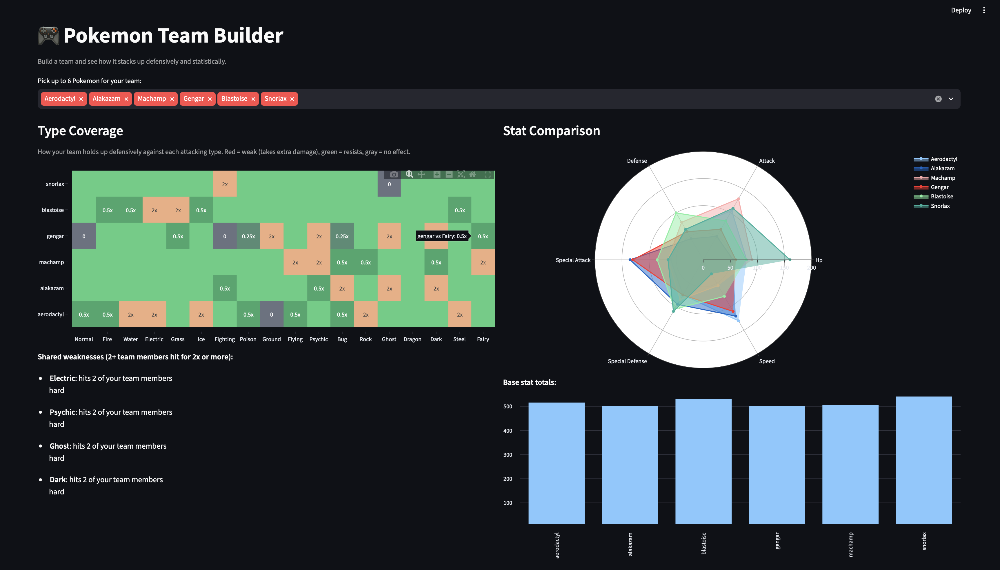

# Pokemon Team Builder

[](https://github.com/mam084/pokemon-team-builder/actions/workflows/tests.yml)

An interactive dashboard for building a Pokemon team and analyzing it: type coverage, shared weaknesses, and stat comparisons across your chosen team.

Built as a portfolio project, developed in stages — this repo is meant to show iterative growth from a basic dashboard toward a deployed ML-based recommender.



## Features

**Stage 1 — Dashboard basics**
- Pulls live Pokemon data (types, base stats, abilities) from [PokeAPI](https://pokeapi.co/)
- Build a team of up to 6 Pokemon via a simple picker
- **Type coverage heatmap** — see at a glance which attacking types your team is weak or resistant to, plus a callout for any shared weaknesses (types that hit 2+ team members hard)
- **Stat comparison** — radar chart and base-stat-total bar chart across your selected team

**Stage 2 — Real competitive usage data**
- Pulls monthly [Smogon usage stats](https://www.smogon.com/stats/) (Gen 9 OU by default) for real-world data on what's actually played
- **Usage share** — approximate meta popularity for each team member
- **Suggested teammates** — for each Pokemon on your team, see who competitive players most commonly pair them with, based on real teammate co-occurrence data
- Bridges PokeAPI's and Smogon's differing name conventions (e.g. `ogerpon-wellspring` vs. `Ogerpon-Wellspring`, `Tapu Koko`, `Mr. Mime`) so both datasets join cleanly

**Stage 3 — Team-aware recommender**
- **Multiple tiers:** start by picking a tier (Gen 9 OU and UU included), or pick a Pokemon first and the app detects the tier it's most used in
- **Recommended additions** for the whole team: each candidate's co-occurrence with every current team member is summed, so a Pokemon that pairs well with several of your picks ranks above one that pairs with just one
- Each recommendation shows which of your team members it's commonly paired with

## Tech Stack

- **Data:** [PokeAPI](https://pokeapi.co/) (REST), fetched concurrently with `concurrent.futures`; [Smogon usage stats](https://www.smogon.com/stats/) (plain text)
- **Processing:** pandas
- **Dashboard:** Streamlit
- **Charts:** Plotly
- **Tests:** stdlib `unittest`, run in CI with GitHub Actions along with an app startup check

## Setup

```bash
# clone and enter the repo
git clone https://github.com/mam084/pokemon-team-builder.git
cd pokemon-team-builder

# install dependencies
pip install -r requirements.txt

# launch the dashboard (processed data for Gen 9 OU and UU is included)
streamlit run app.py
```

To rebuild the data from scratch:

```bash
# fetch and clean the dex data (full national dex recommended)
python src/fetch_data.py --start 1 --end 1025
python src/clean_data.py

# fetch and parse real competitive usage data (optional but recommended -
# check https://www.smogon.com/stats/ for available months)
python src/fetch_usage_data.py --month 2026-06 --format gen9ou
python src/parse_usage_data.py --input data/usage_gen9ou_2026-06.txt --tier gen9ou
```

## Testing

```bash
python -m unittest discover -s tests -v
```

Tests cover the type chart (every matchup checked against current game rules, including immunities and 4x weaknesses), name normalization between PokeAPI and Smogon, and the teammate recommender.

## Project Structure

```
pokemon-team-builder/
├── data/
│   ├── pokemon_raw.json
│   ├── pokemon_clean.csv
│   ├── usage_<tier>_YYYY-MM.txt
│   ├── usage_summary.csv
│   └── teammates.csv
├── docs/
│   └── screenshot.png
├── src/
│   ├── fetch_data.py
│   ├── clean_data.py
│   ├── type_chart.py
│   ├── fetch_usage_data.py
│   ├── parse_usage_data.py
│   ├── name_utils.py
│   └── recommend.py
├── tests/
│   └── test_core.py
├── app.py
├── requirements.txt
├── .gitignore
└── README.md
```

**`data/`** — cached PokeAPI pulls (`pokemon_raw.json`), the tidy dex dataset (`pokemon_clean.csv`), the raw Smogon download, and the tidy usage/teammates CSVs parsed from it.

**`src/`**
- `fetch_data.py` — pulls dex data from PokeAPI (concurrent, resumable)
- `clean_data.py` — raw JSON → tidy DataFrame
- `type_chart.py` — type effectiveness lookup logic
- `fetch_usage_data.py` — downloads Smogon usage stats
- `parse_usage_data.py` — raw Smogon text → tidy usage/teammates CSVs
- `name_utils.py` — bridges PokeAPI ↔ Smogon naming conventions
- `recommend.py` — team-aware teammate recommender (summed co-occurrence across the team)

**`app.py`** — the Streamlit dashboard.

## Roadmap

This project is being built in stages, each a working milestone:

- [x] **Stage 1 — Basic dashboard:** PokeAPI data, type coverage, stat comparison
- [x] **Stage 2 — Real usage data:** incorporated [Smogon usage stats](https://www.smogon.com/stats/) to see what's actually played in the competitive meta, and calculated teammate co-occurrence rates
- [x] **Stage 3 — Basic recommender:** suggest additions for the whole team based on summed co-occurrence, with tier selection
- [ ] **Stage 4 — Upgraded model:** move from co-occurrence counting to learned embeddings (e.g. word2vec-style training on team compositions) for synergy-aware recommendations
- [ ] **Stage 5 — Deploy:** ship as a public web app (Streamlit Community Cloud) so the recommender is live and clickable, not just a notebook

## Data Source

- Pokemon dex data via [PokeAPI](https://pokeapi.co/), a free and open Pokemon API. Type effectiveness values follow current (Gen 6+) game rules.
- Competitive usage and teammate data via [Smogon University's usage stats](https://www.smogon.com/stats/), which are published monthly and freely available. Defaults to the Gen 9 OU format.

**A couple of caveats worth knowing:**
- "Usage Share" in the dashboard is an approximation based on each Pokemon's raw appearance count relative to the dataset total — Smogon's true weighted usage % isn't available from the moveset file this project parses, so treat this as a relative ranking rather than an exact published figure.
- Teammate co-occurrence % is not symmetric — e.g. "of teams running Pokemon A, X% also ran Pokemon B" is a different number than the reverse, since A and B aren't used equally often overall. This is expected and reflects how the underlying data works, not a bug.