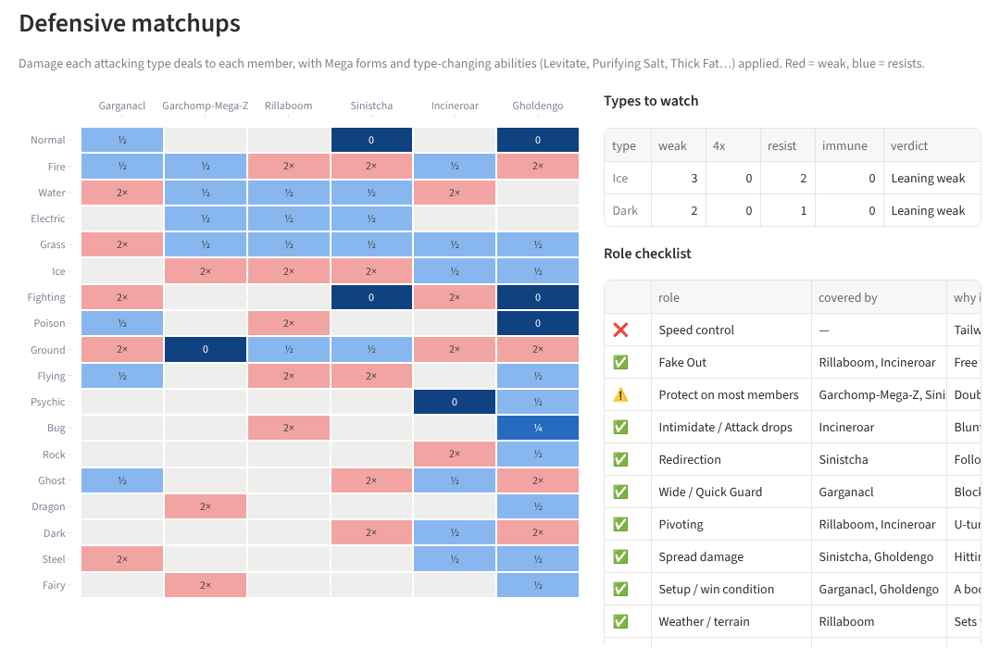

# Pokémon Champions Team Builder

[](https://github.com/mam084/pokemon-team-builder/actions/workflows/tests.yml)
[](https://github.com/mam084/pokemon-team-builder/actions/workflows/refresh-data.yml)

A team builder and analyzer for **Pokémon Champions**, built for the current
regulation (VGC 2026 Reg M-C and Battle Stadium Singles M-C, with Reg M-B kept
for reference). You build full competitive sets, the app checks them against the
regulation's rules, and then it measures the team against what people actually
play on the ladder.



## What it does

**Build a legal team**
- Every Pokémon, Mega Stone, item, ability and move list comes from the
  regulation's legal pool. Pokémon, items and moves are sorted by real usage,
  with each one's usage % shown.
- The editor uses Champions rules: level 50, **66 Stat Points with at most 32
  per stat**, and real level-50 stats for each nature. Mega Pokémon show their Mega
  stats, types and ability.
- When you pick a Pokémon, the app can fill in its most-used set (item, ability,
  spread and moves). It skips items your team already holds, so Item Clause
  is never broken.
- Legality checks cover Species Clause, Item Clause, illegal moves and abilities,
  and Stat Point limits. You also get a warning when more than one Pokémon holds
  a Mega Stone, since only one can Mega Evolve per battle.
- Import and export Showdown pastes.

**Presets and roles**
- **Presets**: up to six common sets for each Pokémon, built from ladder stats.
  Each popular item (and each Mega) starts its own preset. The item shapes the
  rest of the set: Choice items drop status moves and Protect, and Choice Scarf
  picks a max-Speed spread. Apply a preset from the editor, or add one to the
  team straight from the Meta tab. Champions has no IVs; a "spread" is the
  nature plus Stat Points.
- **Roles**: what a Pokémon usually does (Fake Out support, Trick Room or
  Tailwind setter, Rain/Sun/Sand setter, redirector, Intimidate, Choice Scarf
  attacker, priority or spread attacker, bulky...). For meta Pokémon a role
  counts when at least 30% of sets run it, and the share is shown. For your own
  sets, roles come from your moves, item and ability. Roles appear in the team
  strip, the editor, recommendations and the meta views.

**Analyze it**
- **Defensive heatmap** shows how much damage each type does to each member.
  It uses the Mega forms and accounts for abilities that change type matchups
  (Levitate, Purifying Salt, Thick Fat, Water Absorb…). Shared weaknesses are
  flagged.
- **Role checklist**: speed control, Fake Out, Protect, Intimidate, redirection,
  Wide Guard, pivoting, spread damage, weather/terrain, disruption and recovery.
  The doubles-only roles are hidden in Singles.
- **Speed tiers** compare your real Speed stats with the meta's most common
  spreads. There's also a Trick Room view.
- **Offensive coverage** shows what your moves hit super effectively, by type and
  against the 30 most-used Pokémon in their usual battle form.

**Matchups vs the meta**
- Smogon stats don't record whole teams, so the app **rebuilds about 10 common
  meta teams** from teammate data. It starts from a popular Pokémon and keeps
  adding whoever is most often paired with everyone already on the team,
  respecting Species Clause and one Mega per team. Each team is named for what
  it sets up, e.g. *Rain + Tailwind (Archaludon + Pelipper)*, and every
  opponent uses its most popular set.
- Every pairing is decided by **real damage calcs in both directions**, using
  both sides' actual sets: **pair score** = log2(hits they need to KO you ÷
  hits you need to KO them), ±0.5 for Speed (reversed under Trick Room).
  Weather teams are scored in their weather. **Team score** = how well you
  answer their Pokémon minus how well they answer yours, so a mirror match
  scores exactly 0.
- For each meta team you get a verdict, the best **bring 4** (or bring 3 in
  Singles), a pairing heatmap, your best answer to each of their Pokémon with
  the key calc (e.g. *Draco Meteor 83%*), and **counter picks** (meta Pokémon
  that beat that team).
- **Biggest threats**: the 30 most-used Pokémon ranked by
  `usage × (your Pokémon it 2HKOs + 1) ÷ (answers + 1)`, where an *answer*
  2HKOs it back while taking under 50%. Each row shows its hardest hits and
  the meta's best counters to it.

**Damage calculator**
- Level-50 Champions damage with **Showdown's exact formula and rounding**.
  `tests/test_damage.py` checks 102 cases roll-for-roll against Showdown's own
  engine (spread moves, weather, terrain, crits, screens, Helping Hand, stat
  stages, Body Press, Foul Play, Psyshock, Weather Ball, -ate abilities, Mega
  Sol, resist berries, Life Orb...).
- Pick any of your Pokémon or a meta Pokémon's popular set on either side, and
  see each move's damage range, % of HP and KO chance.

**Find what's missing**
- **Recommendations**: every candidate gets five scores from 0 to 1, and you can
  change how much each one counts:

  | signal | meaning |
  |---|---|
  | synergy | how much more often it appears next to your members than chance predicts, averaged over the **whole team** (mean log2 lift from teammate stats, P(B\|A) / P(B)). Lift is shrunk toward 1 for rare Pokémon. No relationship scores 0.33 |
  | defense | how well it resists the types your team is weak to |
  | offense | how well it hits popular Pokémon your team can't hit super effectively (weighted by usage) |
  | roles | whether it brings a role your team is missing |
  | meta | its overall usage, as a prior |

  Each pick also gets a written reason, e.g. *"paired often with Garganacl (2.0x);
  resists Water, Grass, Fighting, Ground"*, and an **Add to team** button that
  adds its most popular set.
- **Meta explorer**: the usage leaderboard and each Pokémon's moves, items,
  abilities, spreads, teammates, and checks & counters.

## How accurate are the recommendations?

The recommender is tested on teams real players brought to
[Limitless](https://play.limitlesstcg.com) tournaments. Those teams are never
used to build it. The test (`src/evaluate.py`): take a real six, **hide one
member, give the other five to the recommender, and see where the hidden
Pokémon ranks** among about 68 candidates. This is repeated
for every member of every team.

Tournaments are split by date. The five signal weights were tuned by grid
search on 4,003 teams from the older tournaments. Every number
below comes from 1,546 teams in the 36 newest
tournaments (2026-11-07 to 2026-11-13), which the tuning
never saw.

| model | top 1 | top 5 | top 10 | MRR |
|---|---|---|---|---|
| tuned weights | 34.9% | 63.0% | 73.8% | 0.477 |
| hand-set weights | 21.6% | 47.5% | 59.3% | 0.345 |
| synergy only | 21.0% | 49.5% | 61.9% | 0.350 |
| popularity only | 6.5% | 35.6% | 47.1% | 0.204 |
| random | 1.5% | 7.3% | 14.7% | 0.071 |

- The tuned weights find the missing Pokémon **first try 35% of the
  time** and in the top 10 74% of the time. That's
  38% better MRR than the
  weights the recommender originally shipped with.
- The tuning learned **synergy 0.57, meta 0.29,
  defense 0.14**, with **offense and roles at 0**: real players pick partners
  that are proven together and patch type weaknesses, more than ones that fill a checklist.
  Those two signals still explain each pick in the app, and you can raise their weights there.
- About 6% of hidden Pokémon are outside the candidate pool
  (the usage top 80), which caps every model's scores.
- `python scripts/evaluate.py` reproduces this. The monthly data refresh re-runs it on new tournaments.

## Data

| What | Source | How it gets here |
|---|---|---|
| Legal Pokémon, Megas, movepools, items, abilities, type chart | [Pokémon Showdown](https://github.com/smogon/pokemon-showdown)'s `champions` mod, the same code that validates teams on the ladder | `scripts/export_dex.js` → `data/dex/<regulation>.json` |
| Usage, sets, teammates, checks & counters | [Smogon monthly usage stats](https://www.smogon.com/stats/) (`chaos` JSON, 1630+ rating) | `scripts/fetch_usage.py` → `data/usage/<format>.json` |
| Real tournament teams (for evaluation) | [Limitless](https://play.limitlesstcg.com) public API, Reg M-C tournaments with 16+ players | `scripts/fetch_tournaments.py` → `data/tournaments/<regulation>.json` |

The **Refresh data** GitHub Action rebuilds all of these on the 3rd of every month,
after Smogon publishes the previous month's stats. It also runs whenever the
data scripts change, and you can start it by hand from the Actions tab. If
anything changed, it commits the new data. So when a new regulation launches,
the only code change is adding it to `src/formats.py` and `scripts/export_dex.js`.

A few things to know about the data:
- Smogon lists each Mega under its own name ("Charizard-Mega-Y"), because that's
  the form that battles. Team sheets list the base Pokémon plus its stone, so the
  app merges the two views (`UsageData.variants`).
- Teammate % is P(B on team | A on team), so it isn't symmetric. The recommender
  uses *lift* so that Pokémon that are just popular everywhere don't dominate the
  results.
- The defensive heatmap is type-based (with the abilities that change type
  matchups). Damage-based views are the Matchups tab and the Damage calc tab.
- Tournament team lists from [Limitless](https://play.limitlesstcg.com) are used
  only to *evaluate* the recommender, never to build it, so the evaluation is
  an honest out-of-sample test.

## Run it

```bash
git clone https://github.com/mam084/pokemon-team-builder.git
cd pokemon-team-builder
pip install -r requirements.txt
streamlit run app.py          # data for every supported format is included
```

Click **Example team** in the sidebar to load a Garganacl team for Reg M-C.
The app has light and dark themes. It follows your device setting by default,
and you can switch in the top-right menu under Settings. Charts change colors
to match.

To rebuild the data yourself:

```bash
# legal dex (needs Node 22 and a built Showdown checkout)
git clone --depth 1 https://github.com/smogon/pokemon-showdown.git ../pokemon-showdown
(cd ../pokemon-showdown && npm ci && node build)
node scripts/export_dex.js --ps ../pokemon-showdown --out data/dex

# usage stats (newest published month, or pass --month YYYY-MM)
python scripts/fetch_usage.py
```

## Tests

```bash
python -m unittest discover -s tests -v
```

The tests check:
- the hand-written type chart against Showdown's exported chart, matchup by matchup
- the Champions stat formula, including nature rounding, and the Stat Point limits
- paste import and export round-trips, including Megas named directly in a paste
- every legality rule
- the damage calculator, roll-for-roll against Showdown's engine
- chaos-file parsing (using a fixture in Smogon's real layout)
- the analysis views, matchups, threats, recommender and evaluation harness
- the app itself, driven headlessly through adding, removing, presets and format
  changes

## Project structure

```
├── app.py                    page layout only
├── ui/                       one module per tab, plus shared state and helpers
├── src/
│   ├── formats.py            supported formats (regulation, singles/doubles, pick count)
│   ├── dex.py                legal-data loader: species, Mega forms, items, learnsets
│   ├── stats.py              Champions stat formula and Stat Point rules
│   ├── team.py               PokemonSet / team model
│   ├── paste.py              Showdown paste import and export
│   ├── legality.py           regulation checks
│   ├── type_chart.py         type effectiveness plus abilities that change matchups
│   ├── usage.py              Smogon chaos parsing, popular sets, team-sheet merging of Megas
│   ├── analysis.py           type matchups, coverage, role checklist, speed tiers
│   ├── damage.py             damage calculator (Showdown-exact)
│   ├── presets.py            common sets assembled from usage stats
│   ├── roles.py              role tags for meta Pokémon and for your sets
│   ├── matchup.py            meta teams, damage-based pair scores, bring-N, counters, threats
│   ├── recommend.py          explainable multi-signal recommender
│   └── evaluate.py           hide-one-member evaluation on real tournament teams
├── scripts/
│   ├── export_dex.js         Showdown → data/dex
│   ├── fetch_usage.py        Smogon → data/usage
│   ├── fetch_tournaments.py  Limitless → data/tournaments
│   ├── evaluate.py           runs the evaluation → data/evaluation
│   └── make_damage_vectors.js  Showdown → damage test vectors
├── data/                     generated data (committed so the app runs without setup)
├── tests/                    unittest suite and fixtures
└── .github/workflows/        tests and the monthly data refresh
```

## Roadmap

- [x] Stage 1: dashboard with type coverage and stat comparison (original PokéAPI version)
- [x] Stage 2: Smogon usage data and teammate co-occurrence
- [x] Stage 3: team-aware recommender
- [x] **Stage 4: Champions rebuild**: regulation-accurate legality, Stat Points,
  Megas, an automated data pipeline, threat analysis, and a multi-signal
  explainable recommender
- [x] Presets, role tags, and team-vs-meta matchups with bring-N and counter picks
- [x] Damage calculator verified against Showdown; damage-based matchups and threats
- [x] Evaluation on real tournament teams, with tuned weights and baselines
- [ ] Stage 5: learned embeddings (e.g. word2vec on tournament team lists) as an extra synergy signal, measured with the same evaluation
- [ ] Deploy to Streamlit Community Cloud
